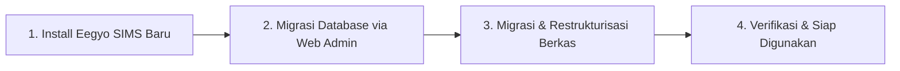

# 🚀 Panduan Migrasi Sistem (MIGRATION.md)
### Dari Eegyo SIMS Versi Lama (Legacy) ke Eegyo SIMS Enterprise

Dokumen ini merupakan panduan langkah demi langkah (*step-by-step tutorial*) bagi sekolah atau pengguna lama yang ingin memindahkan seluruh data dan berkas dari **Eegyo SIMS versi lama** ke sistem baru **Eegyo SIMS Enterprise**.

---

## 📑 Daftar Isi
1. [Prinsip & Alur Kerja Migrasi](#1-prinsip--alur-kerja-migrasi)
2. [Langkah 1: Instalasi Bersih Sistem Baru (Fresh Install)](#langkah-1-instalasi-bersih-sistem-baru-fresh-install)
3. [Langkah 2: Migrasi Database via Portal Admin](#langkah-2-migrasi-database-via-portal-admin)
   - [A. Persiapan di Database Lama (Truncate Notifikasi)](#a-persiapan-di-database-lama-wajib)
   - [B. Export Database Lama (.sql)](#b-export-database-lama-sql)
   - [C. Upload & Eksekusi Migrasi Otomatis](#c-upload--eksekusi-migrasi-otomatis)
4. [Langkah 3: Migrasi & Restrukturisasi Berkas / Media Uploads](#langkah-3-migrasi--restrukturisasi-berkas--media-uploads)
   - [A. Memahami Perbedaan Struktur Penyimpanan](#a-memahami-perbedaan-struktur-penyimpanan)
   - [B. Tabel Matriks Pemetaan Folder (Lama vs Baru)](#b-tabel-matriks-pemetaan-folder-lama-vs-baru)
   - [C. Metode 1: Otomatis via Artisan Command (Sangat Direkomendasikan)](#c-metode-1-otomatis-via-artisan-command-sangat-direkomendasikan)
   - [D. Metode 2: Manual via File Manager / cPanel](#d-metode-2-manual-via-file-manager--cpanel)
5. [Langkah 4: Finalisasi & Verifikasi Pasca Migrasi](#langkah-4-finalisasi--verifikasi-pasca-migrasi)

---

## 1. Prinsip & Alur Kerja Migrasi

Sistem Eegyo SIMS yang baru mengalami perombakan arsitektur besar-besaran:
* **Database**: Menggunakan **108+ tabel ternormalisasi** dengan relasi *foreign key* yang ketat (menggantikan struktur database flat/unnormalized lama).
* **Storage Berkas**: Berkas publik tidak lagi disimpan bercampur di folder root `public/`, melainkan dikelompokkan secara terisolasi dan rapi di dalam `storage/app/public/` melalui symlink publik `public/storage`.

Untuk menjamin kelancaran tanpa ada data yang corrupt atau bertabrakan, **alur migrasi dibagi menjadi 3 tahap berurutan**:



> [!IMPORTANT]
> Jangan mencoba menimpa (*overwrite*) database baru langsung dengan import SQL lama via phpMyAdmin! Database baru memiliki skema dan nama tabel yang berbeda. Selalu gunakan fitur **Web Migrasi Database** yang telah terintegrasi di sistem baru.

---

## Langkah 1: Instalasi Bersih Sistem Baru (Fresh Install)

Sebelum memindahkan data lama, pastikan Anda telah memasang aplikasi Eegyo SIMS baru di server/hosting secara tuntas:

1. Unduh atau clone repositori terbaru ke server Anda.
2. Ikuti panduan instalasi lengkap pada [**INSTALLATION.md**](INSTALLATION.md) (konfigurasi `.env`, inisialisasi database melalui `php artisan migrate --force && php artisan db:seed --force`, dan symlink storage).
3. Pastikan ekstensi **ionCube PHP Loader** telah aktif di server sesuai petunjuk di [**INSTALLATION.md**](INSTALLATION.md).
4. Login ke dashboard sistem baru menggunakan akun Administrator awal.

---

## Langkah 2: Migrasi Database via Portal Admin

### A. Persiapan di Database Lama (WAJIB)

Sebelum melakukan backup/export database lama, ada satu langkah kritis yang harus dilakukan: **mengosongkan tabel `notif_sementara`**.

Tabel `notif_sementara` pada sistem lama berfungsi sebagai penampung antrian pengiriman notifikasi broadcast. Seiring berjalannya waktu, tabel ini bisa membengkak hingga ratusan ribu baris (puluhan bahkan ratusan Megabyte) yang sudah usang dan tidak diperlukan lagi di sistem baru.

Buka phpMyAdmin atau MySQL CLI pada server lama Anda, lalu jalankan perintah SQL berikut:

```sql
TRUNCATE TABLE notif_sementara;
```

> [!TIP]
> Mengosongkan tabel `notif_sementara` akan mempercepat proses ekspor/impor hingga **10x lebih cepat** dan mencegah error *file upload size limit* atau *PHP execution timeout*.

---

### B. Export Database Lama (.sql)

1. Buka **phpMyAdmin** pada server hosting lama Anda.
2. Pilih database Eegyo SIMS lama.
3. Klik tab **Export (Ekspor)**.
4. Pilih metode **Quick (Cepat)** dengan format **SQL**.
5. Klik **Export / Go** dan simpan file `.sql` tersebut ke komputer Anda.

---

### C. Upload & Eksekusi Migrasi Otomatis

1. Buka sistem Eegyo SIMS baru Anda di browser dan login sebagai **Admin**.
2. Di menu navigasi samping, buka menu **Database** > **Migrasi Database** (atau akses URL `/admin/migrasi`).
3. Pada form **Unggah File Database**, pilih file `.sql` database lama yang baru saja Anda download.
4. Klik tombol **"Mulai Migrasi"**.
5. Sistem akan bekerja secara otomatis di background:
   - Membuat database sementara (*temporary staging database*).
   - Membaca seluruh data lama dan mengonversi format ID, foreign key, password hash, serta timestamps.
   - Menyuntikkan data ke tabel-tabel baru (**siswa**, **pegawai**, **users**, **asesmen**, **lms**, **keuangan**, **kantin**, dll.).
   - Menghapus database sementara setelah proses selesai.
6. Setelah selesai, Anda akan disajikan **Laporan Hasil Migrasi** yang menampilkan rincian baris data yang berhasil diimpor per tabel.

---

## Langkah 3: Migrasi & Restrukturisasi Berkas / Media Uploads

### A. Memahami Perbedaan Struktur Penyimpanan

Tantangan terbesar saat migrasi adalah **struktur folder unggahan berkas yang sangat jauh berbeda**:

* **Pada Project Lama**: Berkas diunggah langsung ke dalam folder `public/`, di mana beberapa kategori gambar bercampur baur (misalnya gambar jurusan, fasilitas, dan ekskul bercampur di satu folder `public/img/`; foto siswa dan guru bercampur di `public/foto/`).
* **Pada Project Baru**: Seluruh media terorganisir di dalam `storage/app/public/` dengan subfolder domain yang spesifik.

---

### B. Tabel Matriks Pemetaan Folder (Lama vs Baru)

Berikut adalah panduan pencocokan folder dari project lama ke project baru:

| Folder di Project Lama (`public/`) | Lokasi di Project Baru (`storage/app/public/`) | Keterangan & Catatan Khusus |
| :--- | :--- | :--- |
| `artikel/thumbnail/` | `artikel/` | Thumbnail utama artikel berita/blog |
| `artikel/galeri/` | `galeri/` | Foto dokumentasi kegiatan di dalam artikel |
| `banner/` | `galeri/` | Banner slider selamat datang (dimasukkan ke galeri) |
| `tugas/` | `asesmen/tugas/` | Berkas soal & lampiran tugas siswa |
| `berkas/` | `siswa/berkas/` & `berkas/` | Berkas identitas siswa (KK, SKHU, Ijazah) & berkas arsip pegawai |
| `foto/` *(Siswa)* | `siswa/foto/` | Foto profil siswa / calon siswa |
| `foto/` *(Pegawai/Guru)* | `pegawai/` | Foto profil guru, staf tata usaha, dan admin |
| `pembayaran/` | `siswa/pembayaran/` | Bukti transfer pembayaran SPP & tagihan |
| `img/` *(Jurusan)* | `jurusan/` | Gambar sampul program keahlian / jurusan |
| `img/` *(Fasilitas)* | `fasilitas/` | Foto dokumentasi sarana & prasarana |
| `img/` *(Ekstrakurikuler)* | `ekstrakurikuler/` | Foto kegiatan ekstrakurikuler |
| `ekantin/` | `kantin/` | Foto profil toko kantin |
| `ekantin/produk/` *(atau menu)* | `kantin/produk/` | Foto menu makanan & minuman kantin |
| `lms/` | `lms/` | Modul materi & berkas pembelajaran LMS |
| `uploads/` | `uploads/` | Berkas unduhan umum & lampiran dokumen |
| `pengumuman/` | `pengumuman/` | Berkas lampiran pengumuman resmi |
| `Logo*` *(di root `public/`)* | `sekolah/` | File logo sekolah (misal `Logo.png`, `LogoSekolah.png`, `kop.png`) |

---

### C. Metode 1: Unggah File ZIP via Portal Web Admin (Sangat Direkomendasikan - Tanpa Command CLI!) 🌟

Anda tidak perlu lagi menjalankan command terminal atau repot memindahkan folder satu per satu. Sistem kini menyediakan fitur **Migrasi Berkas via Unggah ZIP** langsung di dalam Dashboard Admin!

#### Cara Penggunaan:
1. **Pilih & Kompres Folder Lama ke File `.zip`**:
   Buka folder `public/` pada project lama Anda di komputer/server. Pilih folder-folder berikut:
   * `artikel`
   * `banner`
   * `berkas`
   * `ekantin`
   * `foto`
   * `img`
   * `lms`
   * `pembayaran`
   * `tugas`
   * `uploads`
   * `pengumuman`
   * File logo (misal `Logo.png`, `LogoSekolah.png`, `kop.png`)
   
   Klik kanan lalu pilih **Compress to ZIP / Buat Arsip ZIP** (beri nama misalnya `berkas_lama.zip`).

2. **Unggah File ZIP di Dashboard Admin**:
   * Buka menu **Database** > **Migrasi Database** (`/admin/migrasi`).
   * Klik tab **"2. Migrasi Berkas & Media (.ZIP)"**.
   * Pilih file `berkas_lama.zip` yang telah Anda buat.
   * Klik tombol **"Mulai Ekstrak & Tata Berkas"**.

3. **Sistem Menata Otomatis**:
   Sistem akan mengekstrak file ZIP dan mencocokkan nama file dengan database baru:
   * Otomatis memisahkan gambar **jurusan**, **fasilitas**, dan **ekstrakurikuler** dari folder `img/`.
   * Otomatis memisahkan **foto siswa** ke `siswa/foto/` dan **foto guru** ke `pegawai/` dari folder `foto/`.
   * Otomatis memindahkan **thumbnail artikel** ke `artikel/` dan **galeri/banner** ke `galeri/`.
   * Otomatis menata berkas **tugas**, **kantin**, **pembayaran**, dan **logo sekolah**.
   * Setelah selesai, Anda akan melihat kartu ringkasan visual jumlah berkas yang berhasil ditata per kategori.

---

### D. Metode 2: Manual via File Manager / cPanel (Alternatif)

Jika Anda ingin memindahkan file secara manual tanpa menggunakan kompresi ZIP:
1. Masuk ke cPanel File Manager `public_html/project_lama/public/`.
2. Salin/pindahkan isi subfolder ke `storage/app/public/` mengikuti [Tabel Matriks Pemetaan Folder (Lama vs Baru)](#b-tabel-matriks-pemetaan-folder-lama-vs-baru).

---

## Langkah 4: Finalisasi & Verifikasi Pasca Migrasi

Setelah database dan berkas selesai dipindahkan, lakukan langkah pemeriksaan akhir:

### 1. Aktifkan Symlink Storage Publik
Pastikan folder `public/storage` telah terhubung ke `storage/app/public`:
```bash
php artisan storage:link
```
*(Di cPanel tanpa SSH, jika wizard instalasi sudah selesai dijalankan, symlink ini biasanya sudah otomatis dibuat).*

### 2. Bersihkan Cache Sistem
Hapus cache aplikasi agar sistem langsung memuat data terbaru:
```bash
php artisan optimize:clear
```

### 3. Uji Coba & Verifikasi Visual
Buka browser dan lakukan pengecekan pada menu-menu berikut:
* **Profil Siswa & Guru**: Pastikan foto profil siswa dan guru muncul dengan benar.
* **Logo Sekolah**: Buka menu Pengaturan Sekolah, pastikan logo dan kop surat terpasang.
* **Artikel & Galeri**: Buka website publik / landing page, periksa gambar thumbnail dan slider.
* **Kantin Digital**: Cek menu kasir kantin dan gambar produk makanan/minuman.
* **Histori Tagihan**: Buka akun Tata Usaha / Bendahara, pastikan riwayat transaksi pembayaran dan tunggakan siswa telah sinkron.

---

## 🛡️ Langkah Keamanan Pasca Migrasi

1. **Hapus File SQL Backup**: Pastikan file backup `.sql` yang tadi Anda upload tidak tertinggal di folder publik web server.
2. **Ubah Password Super Admin**: Segera perbarui kata sandi akun Administrator Anda demi menjaga keamanan sistem baru.

---

<p align="center">
  <strong>Selamat! Proses migrasi Eegyo SIMS Anda telah selesai dengan sempurna. 🎉</strong>
</p>
