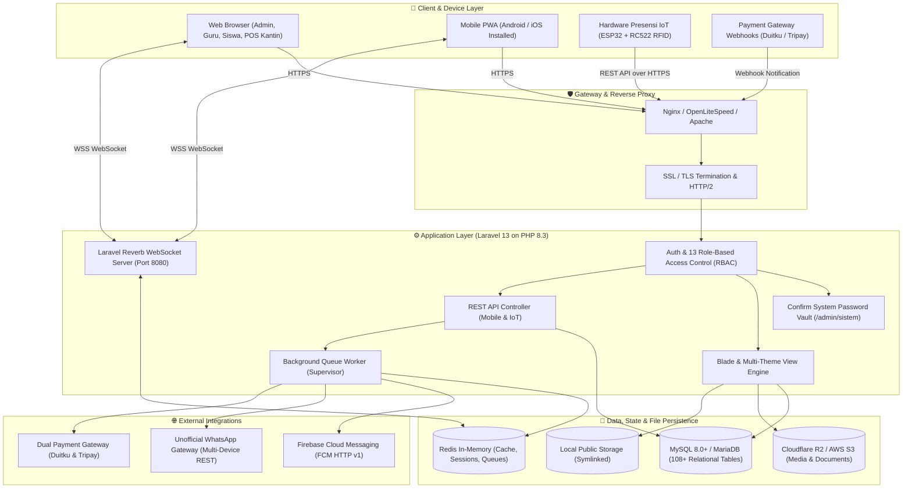

# 🛠️ Eegyo SIMS — Technology Stack & Architecture Specifications

  

  <strong>Dokumentasi Komprehensif Arsitektur Perangkat Lunak, Framework, Pustaka, Layanan Cloud, dan Integrasi Perangkat Keras</strong>

  
  
  
  
  
  
  
  
  
  
  
  

---

## 📑 Daftar Isi

1. [Ringkasan Eksekutif](#-ringkasan-eksekutif)
2. [Kemudahan Konfigurasi & Dashboard Pengaturan Terpadu (Zero-Terminal GUI)](#-kemudahan-konfigurasi--dashboard-pengaturan-terpadu-zero-terminal-gui)
3. [Diagram Arsitektur Sistem](#-diagram-arsitektur-sistem)
4. [Tabel Matriks Teknologi (Core Tech Matrix)](#-tabel-matriks-teknologi-core-tech-matrix)
5. [Rincian Komponen Teknologi](#-rincian-komponen-teknologi)
    - [A. Backend & Core Framework](#a-backend--core-framework)
    - [B. Database, Cache & Queue System](#b-database-cache--queue-system)
    - [C. Realtime WebSocket & Event Broadcasting](#c-realtime-websocket--event-broadcasting)
    - [D. Frontend & UI/UX Design System](#d-frontend--uiux-design-system)
    - [E. Progressive Web App (PWA)](#e-progressive-web-app-pwa)
    - [F. Integrasi Hardware & Internet of Things (IoT)](#f-integrasi-hardware--internet-of-things-iot)
    - [G. Cloud Storage & CDN Distribution](#g-cloud-storage--cdn-distribution)
    - [H. Multi Payment Gateway (Duitku & Tripay)](#h-multi-payment-gateway-duitku--tripay)
    - [I. Komunikasi & Unofficial WhatsApp Gateway](#i-komunikasi--unofficial-whatsapp-gateway)
    - [J. Pengolahan Dokumen, Media & Barcode](#j-pengolahan-dokumen-media--barcode)
    - [K. Keamanan, Proteksi Lisensi & Vault Area](#k-keamanan-proteksi-lisensi--vault-area)
    - [L. Development, Testing & Code Quality Tools](#l-development-testing--code-quality-tools)
6. [Rekomendasi Spesifikasi Server (Infrastructure Sizing)](#-rekomendasi-spesifikasi-server-infrastructure-sizing)

---

## 📌 Ringkasan Eksekutif

**Eegyo SIMS** (Aplikasi Sekolah Super Lengkap) dirancang dengan pendekatan arsitektur modern berbasis micro-monolith yang sangat modular, efisien, dan siap melayani ribuan transaksi bersamaan (_high concurrency_). Sistem mengombinasikan ketangguhan **Laravel 13** dan efisiensi **PHP 8.3 JIT**, komunikasi latensi rendah menggunakan protokol native WebSocket **Laravel Reverb**, asset pipeline modern via **Vite 8**, sistem penyimpanan terdistribusi **Cloudflare R2 (S3-compatible)**, integrasi **Dual Payment Gateway (Duitku & Tripay)**, notifikasi **Unofficial WhatsApp Gateway** hemat biaya, serta dukungan hardware mandiri berbasis mikrokontroler **ESP32 & RFID**.

---

## 🎛️ Kemudahan Konfigurasi & Dashboard Pengaturan Terpadu (Zero-Terminal GUI)

Salah satu keunggulan terbesar dari **Eegyo SIMS** adalah **kemudahan operasional bagi administrator**. Anda **tidak perlu mengutak-atik kode program atau mengedit file `.env` secara manual di terminal server** untuk mengaktifkan seluruh fitur integrasi modern:

> [!TIP]
> **Pusat Kontrol Visual Mandiri (Zero-Code / Zero-Terminal Setup)**:
> Seluruh konfigurasi penting telah kami sediakan dalam bentuk **Antarmuka Grafis (GUI Dashboard)** yang ramah pengguna, modern, dan aman:
>
> 1. **Portal Pengaturan Sistem (`/admin/sistem`)**:
>    - Dilindungi lapisan keamanan **Always-Locked Password Vault** (`PASSWORD_SISTEM`).
>    - Form GUI instan untuk Database, Cache, Redis, Reverb WebSocket, Cloudflare R2 / AWS S3, dan Email SMTP.
>    - Fitur upload langsung file **Google Firebase Service Account JSON** tanpa perlu menyalin kode rumit.
>    - Tombol uji koneksi langsung (*Uji Koneksi FCM*, *Uji Eksekusi Cron Job*).
>    - Konsol terminal interaktif langsung di web browser untuk menjalankan perintah perawatan (`artisan optimize`, `cache:clear`, dll).
> 2. **Portal Multi Payment Gateway (`/admin/payment-gateway`)**:
>    - Pilihan aktifasi instan antara **Duitku** atau **Tripay** cukup dengan satu klik tombol radio.
>    - Input kredensial API Key, Merchant Code, dan Private Key dengan opsi pengalihan cepat antara mode **Sandbox (Testing)** dan **Production (Live)**.
>    - Generator & tombol salin otomatis untuk URL Webhook Callback dan Return URL.
> 3. **Portal WhatsApp Gateway (`/admin/wa-gateway`)**:
>    - Dashboard manajemen perangkat pengirim pesan WhatsApp berbasis Unofficial Gateway (Wablas / Fonnte / dsb).
>    - Pemasangan multi-device sender dan monitoring status koneksi perangkat langsung dari panel admin.
> 4. **Portal Saluran Notifikasi Event (`/admin/aplikasi`)**:
>    - Pengaturan *toggle switch* untuk menentukan saluran mana yang aktif (WhatsApp, Push Notification Browser FCM, atau keduanya) pada setiap skenario kejadian: Presensi Masuk, Presensi Pulang, Tagihan SPP, Keterlambatan, dan Pengumuman.

---

## 🏛️ Diagram Arsitektur Sistem

Arsitektur sistem Eegyo SIMS menghubungkan multi-klien (browser, PWA, perangkat IoT, dan webhook penyedia pihak ketiga) ke klaster aplikasi yang aman dan skalabel:

---

## 📊 Tabel Matriks Teknologi (Core Tech Matrix)

Berikut rekapitulasi spesifikasi teknologi dan dependensi utama yang digunakan dalam Eegyo SIMS:

| Kategori                   | Teknologi / Library                                                                                                       | Versi            | Peran & Implementasi                                                                   |
| :------------------------- | :------------------------------------------------------------------------------------------------------------------------ | :--------------- | :------------------------------------------------------------------------------------- |
| **Runtime**                | [PHP](https://www.php.net/)                                                                                               | `^8.3`           | Engine eksekusi utama, typing ketat, Enums, Fibers, dan JIT compiler.                  |
| **Backend Framework**      | [Laravel Framework](https://laravel.com/)                                                                                 | `^13.7`          | Framework MVC enterprise, Eloquent ORM, Routing, Queue, Events, dan Artisan.           |
| **Realtime Server**        | [Laravel Reverb](https://reverb.laravel.com/)                                                                             | `^1.0`           | Server WebSocket native berkinerja tinggi untuk sinkronisasi pesanan kasir & presensi. |
| **Client WebSocket**       | [Laravel Echo](https://github.com/laravel/echo) & [Pusher JS](https://pusher.com/)                                        | Standard         | Abstraksi langganan channel publik, privat, dan presence dari browser.                 |
| **Database (RDBMS)**       | [MySQL](https://www.mysql.com/) / [MariaDB](https://mariadb.org/)                                                         | `8.0+` / `10.4+` | RDBMS utama dengan 108+ tabel ternormalisasi, foreign key cascade, dan InnoDB.         |
| **In-Memory Cache**        | [Redis](https://redis.io/) via `predis/predis`                                                                            | `7.x`            | Cache performa tinggi, state session kilat, dan driver antrean (queue).                |
| **Asset Pipeline**         | [Vite](https://vitejs.dev/)                                                                                               | `^8.0.0`         | Bundler modul modern generasi terbaru dengan Hot Module Replacement (HMR).             |
| **Laravel Vite Plugin**    | [laravel-vite-plugin](https://github.com/laravel/vite-plugin)                                                             | `^3.1`           | Integrasi asset Blade template dan multi-tema frontend.                                |
| **CSS Framework (Themes)** | [Tailwind CSS](https://tailwindcss.com/)                                                                                  | `^3.1` / `^4.0`  | Utility-first CSS untuk landing page dan 4 tema publik terisolasi.                     |
| **CSS Framework (Admin)**  | [Bootstrap 5](https://getbootstrap.com/) & [Sneat](https://themeselection.com/)                                           | `5.3+`           | Dashboard admin enterprise, layout responsif, komponen form, dan modal.                |
| **Icons Library**          | [Bootstrap Icons](https://icons.getbootstrap.com/)                                                                        | `^1.13.1`        | Set ikon antarmuka untuk navigasi menu dan tombol aksi.                                |
| **Reactive Client**        | [Alpine.js](https://alpinejs.dev/)                                                                                        | `^3.4.2`         | Deklaratif reaktif ringan untuk komponen dropdown, tab, dan toggle UI.                 |
| **Data Tables**            | [DataTables.net](https://datatables.net/)                                                                                 | `^2.3.8`         | Grid tabel interaktif dengan pencarian instan, sorting, dan pagination server-side.    |
| **Alert & Dialog**         | [SweetAlert2](https://sweetalert2.github.io/)                                                                             | `^11.26.25`      | Modal konfirmasi elegan, notifikasi popup sukses/gagal, dan toast.                     |
| **Slider / Carousel**      | [Swiper](https://swiperjs.com/)                                                                                           | `^12.2.0`        | Carousel sentuh responsif untuk banner, pengumuman, dan materi visual.                 |
| **Animasi & Galeri**       | [AOS](https://michalsnik.github.io/aos/) & [GLightbox](https://biati-digital.github.io/glightbox/)                        | `^2.3` / `^3.3`  | Efek transisi saat scroll (AOS) dan lightbox penampil foto beresolusi tinggi.          |
| **Cloud Storage Engine**   | [AWS S3 Flysystem Adapter](https://flysystem.thephpleague.com/)                                                           | `3.0`            | Integrasi native ke **Cloudflare R2** (S3-compatible) & AWS S3.                        |
| **Pengolahan Gambar**      | [Intervention Image Laravel](https://image.intervention.io/)                                                              | `v3.x`           | Resize gambar otomatis, kompresi foto siswa, dan driver GD/Imagick.                    |
| **Generator Dokumen PDF**  | [Laravel DomPDF](https://github.com/barryvdh/laravel-dompdf)                                                              | `^3.1`           | Render PDF untuk lembar rapor, kartu peserta ujian, kwitansi, dan invoice.             |
| **Generator Spreadsheet**  | [PhpSpreadsheet](https://phpspreadsheet.readthedocs.io/)                                                                  | `^5.8`           | Import/Export data massal siswa, guru, rekap nilai, dan buku kas Excel.                |
| **Generator Word**         | [PHPWord](https://phpword.readthedocs.io/)                                                                                | `^1.4`           | Export template surat kedinasan, surat panggilan orang tua, dan dokumen resmi.         |
| **Generator Barcode/QR**   | [Simple-QRCode](https://www.simplesoftware.io/#/docs/simple-qrcode) & [BaconQrCode](https://github.com/Bacon/BaconQrCode) | `^2.0`           | Pembuatan QR Code kartu pelajar digital, presensi dinamis, dan kode bayar.             |
| **Payment Gateway**        | [Duitku](https://www.duitku.com/) & [Tripay](https://tripay.co.id/)                                                       | API v1.5 / v2    | Multi-gateway pembayaran otomatis QRIS Dinamis, Virtual Account Bank, dan Gerai Retail.|
| **WhatsApp Gateway**       | [Unofficial WhatsApp API](https://wablas.com/) (Wablas, Fonnte, Baileys)                                                  | Multi-Device REST| Notifikasi otomatis presensi, tagihan SPP, dan broadcast langsung dari nomor sekolah tanpa biaya WABA.|
| **Push Notification**      | [Firebase Cloud Messaging](https://firebase.google.com/docs/cloud-messaging)                                              | HTTP v1 API      | Notifikasi push native ke web browser & perangkat Android/iOS via Service Account.     |
| **Hardware IoT Presensi**  | [ESP32 DevKit](https://www.espressif.com/) / [NodeMCU](https://nodemcu.net/)                                              | C++ / Arduino    | Mesin presensi mandiri RFID RC522 dengan mode offline buffering.                       |
| **Sistem Proteksi**        | [ionCube PHP Loader](https://www.ioncube.com/)                                                                            | `v13+` / `v14+`  | Enkripsi bytecode core logika bisnis dan validasi lisensi sekolah.                     |

---

## 🔍 Rincian Komponen Teknologi

### A. Backend & Core Framework

1. **PHP 8.3+**:
    - Memanfaatkan fitur modern PHP terkini: _typed properties 2.0_, _match expressions_, _readonly classes_, _enumerations_, dan optimasi eksekusi _JIT (Just-In-Time) compilation_.
    - Standar penulisan berbasis PSR-4 (autoloading) dan PSR-12 (standar penulisan kode).

2. **Laravel 13.x**:
    - Menjadi tulang punggung (_backbone_) seluruh operasi sistem.
    - Menggunakan fitur arsitektur terkini:
        - **Eloquent ORM** dengan relasi relasional terindeks untuk query berkinerja tinggi.
        - **Form Request Validation** yang memisahkan validasi data input dari controller.
        - **Service Pattern Layer** (`AppConfigService`, `LicenseService`, `R2StorageService`, `SchoolStatusService`, dll.) untuk memisahkan domain logika bisnis dari antarmuka controller.
        - **Custom Artisan CLI Commands** untuk automasi perawatan, sinkronisasi data, dan background processing.

3. **Multi-Role RBAC (Role-Based Access Control)**:
    - Terdiri dari **13 Portal Role Terisolasi**: Admin, Kepala Sekolah, Tata Usaha, Bendahara, Guru, Wali Kelas, Guru Piket, Guru BK, Panitia PPDB, Koperasi, Kantin POS, Siswa, dan Pendaftar Baru.
    - Pengecekan izin bertingkat menggunakan Middleware kustom (`RoleMiddleware`, `LicenseMiddleware`, `SchoolActiveMiddleware`).

---

### B. Database, Cache & Queue System

1. **Relational Database (MySQL 8.0+ / MariaDB 10.4+)**:
    - Database dirancang dengan **108+ tabel relasional** ternormalisasi.
    - Menggunakan format karakter `utf8mb4_unicode_ci` untuk dukungan penuh teks multibahasa dan simbol.
    - Mengimplementasikan _Foreign Key Constraints_ dengan `ON DELETE CASCADE` atau `ON DELETE RESTRICT` sesuai integritas data sekolah.
    - Indeks kolom strategis pada foreign keys, nomor induk (NIS/NIP/NIK), tanggal, dan status transaksi untuk query pencarian cepat.

2. **In-Memory Layer (Redis 7.x)**:
    - **Cache Driver**: Menyimpan hasil query konfigurasi sekolah (`sekolah()`), lisensi, dan master data statis untuk menghemat beban baca database secara drastis.
    - **Session Driver**: State sesi autentikasi disimpan di Redis agar mendukung arsitektur _multi-instance horizontal load balancing_.
    - **Queue Driver**: Mengelola antrean pengiriman email masal, notifikasi push FCM, pesan WhatsApp, dan sinkronisasi log transaksi kasir kantin.

---

### C. Realtime WebSocket & Event Broadcasting

1. **Laravel Reverb 1.x**:
    - Server WebSocket modern berdaya tampung tinggi yang dibangun khusus untuk ekosistem Laravel.
    - Beroperasi sebagai background daemon (secara default pada port `8080` dan diproxy melalui WSS port `443`).
    - Tidak memerlukan dependensi pihak ketiga berbayar seperti Pusher cloud.

2. **Event & Channels**:
    - **Live Order POS Kantin**: Notifikasi pesanan makanan/minuman siswa masuk seketika ke layar kasir kantin tanpa reload halaman.
    - **Live Feed Presensi**: Notifikasi kehadiran siswa langsung terpampang di monitor piket/gerbang saat kartu RFID di-tap.
    - **Broadcast Notifikasi Sistem**: Pengumuman penting sekolah yang disiarkan langsung ke seluruh portal yang sedang aktif.

---

### D. Frontend & UI/UX Design System

1. **Vite 8.x Bundler**:
    - Asset bundler ultra-cepat dengan arsitektur ESM (_ECMAScript Modules_).
    - Mengompilasi puluhan entry points (CSS, JS, dan bundle spesifik tema) secara otomatis dan memproduksi file aset minifikasi dengan teknik _cache-busting hash_.

2. **Dual-Design System (Hybrid Framework)**:
    - **Portal Admin & Manajemen (Bootstrap 5.x + Sneat Admin Template)**:
        - Dikhususkan untuk dashboard operasional dengan banyak formulir, tabel data masif, modal konfirmasi, dan grafik performa.
        - Menggunakan tema responsif modern dengan dukungan _collapsible sidebar_, _dark/light mode_, dan _perfect scrollbar_.
    - **Landing Page & Portal Publik (Tailwind CSS 3/4 + Alpine.js)**:
        - Tersedia sistem **Multi-Theme Dinamis** yang dapat diganti sewaktu-waktu oleh pihak sekolah melalui menu pengaturan sistem:
            - 🌟 _Default Theme_ (Elegan & Korporat)
            - 🍃 _Hijau Theme_ (Bernuansa Islami / Pesantren / Madrasah)
            - ⚡ _Neo-Brutalism Theme_ (Modern, Trendi & Kontras Tinggi)
            - 🚀 _Cyberpunk Theme_ (Futuristik, Dark Neon & Berkarakter)

3. **Komponen Interaktif Klien**:
    - **SweetAlert2**: Notifikasi feedback visual, konfirmasi hapus data, dan modal input cepat.
    - **DataTables 2.x**: Penyajian data siswa, keuangan, dan log sistem dengan dukungan pencarian instan, sorting dinamis, export data, dan pagination cepat.
    - **Alpine.js 3.x**: Logika interaktif ringan pada komponen dropdown, toggle visibilitas password, dan dynamic tabs tanpa perlu framework SPA yang berat.

---

### E. Progressive Web App (PWA)

- **Instalasi Mandiri**: Aplikasi dapat di-install langsung di layar utama smartphone (Android & iOS) serta desktop (Windows / macOS) layaknya aplikasi native melalui menu _"Add to Home Screen"_.
- **Web App Manifest (`manifest.json`)**: Mengonfigurasi nama aplikasi dinamis sesuai nama sekolah, ikon multi-resolusi, warna tema status bar, dan orientasi layar.
- **Service Worker (`sw.js`)**: Mengelola _caching strategy_ untuk aset statis (CSS, JavaScript, font, dan logo) sehingga aplikasi terbuka seketika (_instant shell load_).

---

### F. Integrasi Hardware & Internet of Things (IoT)

Sistem presensi Eegyo SIMS mendukung perangkat pembaca kartu RFID fisik tanpa perlu operator manusia:

- **Mikrokontroler Utama**: **ESP32 DevKit V1** (Dual-Core 240MHz, Wi-Fi 802.11 b/g/n, Bluetooth v4.2) atau **NodeMCU ESP8266**.
- **Sensor RFID**: **RC522** (Frekuensi 13.56 MHz, standar ISO/IEC 14443 Type A / Kartu Mifare 1K) atau **PN532**.
- **Konektivitas Cadangan**: Modul **GSM SIM800L** (GPRS HTTP POST) untuk area sekolah yang belum terjangkau jaringan Wi-Fi lokal.
- **Protokol Komunikasi**: REST API JSON terenkripsi dengan otentikasi Device UUID & Bearer Token.
- **Mode Tangguh Offline-First**: Jika koneksi internet sekolah sempat terputus, firmware perangkat IoT secara otomatis menampung data ketukan (_tap buffer_) ke dalam memori internal (SPIFFS/EEPROM) dan melakukan sinkronisasi otomatis (_auto-sync retry_) saat koneksi internet kembali pulih.

---

### G. Cloud Storage & CDN Distribution

- **Adapter Cloud Object Storage**: Menggunakan driver `league/flysystem-aws-s3-v3` yang kompatibel dengan protokol AWS S3.
- **Cloudflare R2 Storage**:
    - Menyimpan berkas upload pengguna (foto profil, berkas pendaftaran PPDB, file materi modul ujian CBT, dan backup data).
    - Terhubung langsung dengan CDN Cloudflare global untuk distribusi gambar instan ke seluruh dunia dengan **bebas biaya transfer data keluar (Zero Egress Fees)**.
- **Local Fallback Storage**: Mendukung penyimpanan lokal mandiri (`storage/app/public`) dengan sistem symbolic link publik (`public/storage`) untuk instalasi pada server offline (intranet sekolah) atau shared hosting standar.

---

### H. Multi Payment Gateway (Duitku & Tripay)

Eegyo SIMS mengadopsi arsitektur **Payment Gateway Manager** cerdas (`App\Services\PaymentGatewayManager`) yang memungkinkan lembaga pendidikan berganti penyedia gerbang pembayaran secara instan tanpa perlu memodifikasi alur belanja atau database:

1. **Duitku Payment Gateway**:
    - **Protokol**: Integrasi REST Web API Duitku (mendukung Sandbox Testing & Production Live).
    - **Metode Pembayaran Lengkap**:
        - **QRIS Dinamis**: Pembayaran instan via scan aplikasi BCA Mobile, GoPay, OVO, DANA, ShopeePay, LinkAja, dan seluruh aplikasi m-banking berstandar QRIS.
        - **Virtual Account Multi-Bank**: BCA, Mandiri, BRI, BNI, BSI (Bank Syariah Indonesia), Permata, CIMB Niaga, Danamon, dan Neo Commerce.
        - **Gerai Retail**: Indomaret, Alfamart, dan Pos Indonesia.
    - **Keamanan Signature**: Verifikasi checksum keamanan transaksi menggunakan enkripsi `MD5` (`merchantCode + amount + merchantOrderId + apiKey`).
    - **Fitur Khusus**: Masa kedaluwarsa tagihan fleksibel (*expiry period*), direct payment URL, dan pengecekan status transaksi instan.

2. **Tripay Payment Gateway**:
    - **Protokol**: Integrasi Closed Transaction API v2 Tripay (Sandbox & Production).
    - **Metode Pembayaran**: QRIS Dinamis, Virtual Account Bank Nasional & Syariah, serta Convenience Store (Alfamart / Alfamidi / Indomaret).
    - **Keamanan Signature**: Validasi callback webhook otomatis menggunakan enkripsi signature `HMAC-SHA256` berbasis Private Key.

3. **Kemudahan Konfigurasi Melalui GUI Dashboard (`/admin/payment-gateway`)**:
    - Administrator sekolah **tidak perlu menyentuh file konfigurasi teknis**:
        - Pilihan gateway aktif (**Duitku**, **Tripay**, atau dinonaktifkan) cukup dengan memilih radio button.
        - Input kredensial Merchant Code, API Key, dan Private Key langsung dari form web.
        - Tersedia tombol *Copy to Clipboard* untuk URL Webhook Callback dan Return URL yang siap dipasang langsung di dashboard merchant Duitku maupun Tripay.
        - Sinkronisasi otomatis: saat pembayaran terverifikasi oleh gateway, sistem seketika melunasi tagihan SPP, mengaktifkan pendaftaran PPDB, atau menambah saldo dompet digital kantin siswa tanpa keterlibatan manual operator.

---

### I. Komunikasi & Unofficial WhatsApp Gateway

Sistem dilengkapi kanal komunikasi terintegrasi untuk menjembatani pihak sekolah dengan orang tua dan siswa secara *real-time*:

1. **Unofficial WhatsApp Gateway (Multi-Device REST API)**:
    - **Filosofi & Efisiensi Biaya**: Eegyo SIMS secara spesifik dirancang mendukung **Unofficial WhatsApp Gateway** (kompatibel dengan penyedia API seperti Wablas, Fonnte, WhaCenter, maupun server gateway mandiri Node.js Baileys).
    - **Bebas Biaya Tarif Meta WABA**: Sekolah dapat menghubungkan nomor kartu SIM resmi milik sekolah sendiri untuk menyiarkan puluhan ribu pesan notifikasi **tanpa harus membayar biaya per pesan (*per-conversation fee*) dari Meta Cloud API resmi yang mahal**.
    - **Notifikasi Presensi & Tagihan Otomatis**:
        - Notifikasi kehadiran real-time ke nomor WhatsApp orang tua ketika siswa melakukan tap kartu RFID di gerbang sekolah (status: Masuk, Pulang, atau Terlambat).
        - Notifikasi tagihan SPP bulanan, rincian pembayaran, dan tanda terima digital.
        - Broadcast pengumuman sekolah, surat pemanggilan orang tua oleh Guru BK, dan jadwal asesmen.
    - **Dashboard Pengaturan WhatsApp (`/admin/wa-gateway`)**:
        - Tambah dan kelola beberapa perangkat WhatsApp Sender (*Multi-Device*).
        - Monitoring status koneksi perangkat dan kuota pengiriman langsung dari layar web.

2. **Firebase Cloud Messaging (FCM HTTP v1 API)**:
    - Notifikasi push native yang muncul langsung di status bar smartphone Android/iOS maupun desktop browser (Chrome, Edge, Firefox).
    - **Kemudahan Integrasi di Menu Sistem**: Admin cukup mengunggah berkas `service-account.json` dari Firebase Console langsung ke form halaman `/admin/sistem`—tanpa perlu meletakkan berkas secara manual di server backend.
    - Dilengkapi tombol *Uji Koneksi Google FCM* untuk memastikan token autentikasi Google Cloud aktif dan valid.

3. **Matriks Pengaturan Saluran Notifikasi (`/admin/aplikasi`)**:
    - Kemudahan penuh bagi pihak sekolah: setiap skenario kejadian (Presensi, Keterlambatan, SPP, Pengumuman) memiliki pengaturan switch tersendiri di panel admin. Sekolah bebas memilih apakah notifikasi dikirimkan melalui **WhatsApp saja**, **Push Notifikasi Aplikasi saja**, **Keduanya**, atau **Dinonaktifkan**.

4. **Email Notifications (Symfony Mailer)**:
    - Pengiriman berkas bukti bayar, faktur, laporan rekap, serta tautan reset password menggunakan protokol SMTP standar (mendukung Google Workspace, Mailgun, Brevo, SendGrid, maupun server mail lokal cPanel).

---

### J. Pengolahan Dokumen, Media & Barcode

- **Intervention Image v3**: Kompresi foto otomatis sebelum disimpan ke storage untuk menghemat ruang disk hingga 70% tanpa mengurangi ketajaman foto kartu pelajar.
- **DomPDF 3.x**: Render dokumen dinamis dari Blade view menjadi berkas PDF siap cetak dengan akurasi ukuran kertas standar (A4, F4/Folio).
- **PhpSpreadsheet 5.8+ & PHPWord 1.4+**: Pemrosesan berkas office untuk template surat resmi sekolah, kartu peserta ujian, serta export laporan rekap kehadiran ke format Microsoft Excel.
- **BaconQrCode & Simple-QRCode**: Generator barcode 2D (QR Code) beresolusi tinggi dengan format SVG atau PNG base64 untuk verifikasi keaslian dokumen digital dan kartu tanda pengenal.

---

### K. Keamanan, Proteksi Lisensi & Vault Area

1. **Area Sistem Berlapis ("Always-Locked" System Vault)**:
    - Menu Pengaturan Sistem (`/admin/sistem*`) diproteksi menggunakan middleware khusus `ConfirmSystemPasswordMiddleware` dengan verifikasi kunci `PASSWORD_SISTEM`.
    - Menggunakan prinsip _auto-lock on departure_: setiap kali pengguna berpindah ke modul lain, sesi kunci sistem langsung direset otomatis demi mencegah akses tidak sah jika sesi browser admin ditinggalkan terbuka.

2. **Sistem Proteksi Source Code & Lisensi (ionCube)**:
    - Modul inti bisnis dan verifikasi lisensi dienkripsi menggunakan ionCube Encoder (PHP 8.3 target).
    - Menjamin integritas kode, keaslian lisensi per-domain sekolah, dan perlindungan kekayaan intelektual (IP) aplikasi.

3. **Standar Kriptografi & Proteksi Web**:
    - Enkripsi data menggunakan algoritma **AES-256-CBC** dengan master key `APP_KEY`.
    - Hashing password menggunakan algoritma **Bcrypt** atau **Argon2id** berstandar industri.
    - Proteksi otomatis terhadap **CSRF (Cross-Site Request Forgery)** pada setiap request mutasi data (`POST`, `PUT`, `DELETE`).
    - Pencegahan **SQL Injection** secara menyeluruh dengan prepared statement PDO.
    - Pencegahan **XSS (Cross-Site Scripting)** melalui sanitasi otomatis sintaks Blade `{{ }}`.
    - Rate limiting bawaan (`throttle:api`) untuk menangkal serangan brute-force pada endpoint autentikasi dan IoT.

---

### L. Development, Testing & Code Quality Tools

- **Concurrently**: Eksekusi multi-proses secara paralel dalam satu terminal pengembang (`php artisan serve`, `php artisan queue:listen`, `php artisan pail`, dan `npm run dev`).
- **Laravel Pint**: Linter kode berbasis PHP-CS-Fixer dengan preset standar Laravel untuk menjaga konsistensi format kode.
- **Laravel Pail**: Tool pemantau log aplikasi secara real-time langsung dari command line.
- **Laravel Tinker**: REPL interaktif berbasis PsySH untuk eksperimen query database dan debugging fungsi secara langsung.
- **PHPUnit 12.x & Mockery 1.6**: Framework pengujian unit test dan integration test otomatis.

---

## 🖥️ Rekomendasi Spesifikasi Server (Infrastructure Sizing)

Untuk memastikan aplikasi berjalan dengan performa maksimal pada lingkungan produksi, berikut panduan kebutuhan infrastruktur berdasarkan skala siswa:

| Kriteria Skala         | Skala Kecil (s.d 500 Siswa)    | Skala Menengah (500 - 2.500 Siswa)         | Skala Besar / Kampus (2.500+ Siswa)           |
| :--------------------- | :----------------------------- | :----------------------------------------- | :-------------------------------------------- |
| **Processor (CPU)**    | 2 vCPU                         | 4 vCPU                                     | 8+ vCPU                                       |
| **Memori (RAM)**       | 2 GB - 4 GB                    | 8 GB                                       | 16 GB - 32 GB                                 |
| **Web Server**         | Nginx / OpenLiteSpeed          | Nginx (PHP-FPM Pool tuned)                 | Nginx Cluster + Load Balancer                 |
| **Database**           | MySQL 8.0 (Single Instance)    | MariaDB / MySQL (Tuned Buffer Pool)        | Dedicated DB Server / Replica Read-Write      |
| **Cache & Queue**      | File / Database / Redis Lokal  | Redis Server Dedicated                     | Redis Cluster (Sentinel / Master-Replica)     |
| **WebSocket**          | Laravel Reverb (Single Thread) | Laravel Reverb + Supervisor (Multi-Worker) | Laravel Reverb Dedicated Node + Redis Adapter |
| **Penyimpanan Berkas** | Local Storage (SSD NVMe)       | Cloudflare R2 / AWS S3                     | Cloudflare R2 + CDN Caching Edge              |
| **Rekomendasi OS**     | Ubuntu 22.04 / 24.04 LTS       | Ubuntu 22.04 / 24.04 LTS                   | Ubuntu 24.04 LTS / Debian 12                  |

---

  <strong>Eegyo SIMS Core Architecture & Tech Stack Documentation</strong> 
  Dokumentasi ini dipelihara secara berkala mengikuti perkembangan versi dependensi dan teknologi terbaru.

